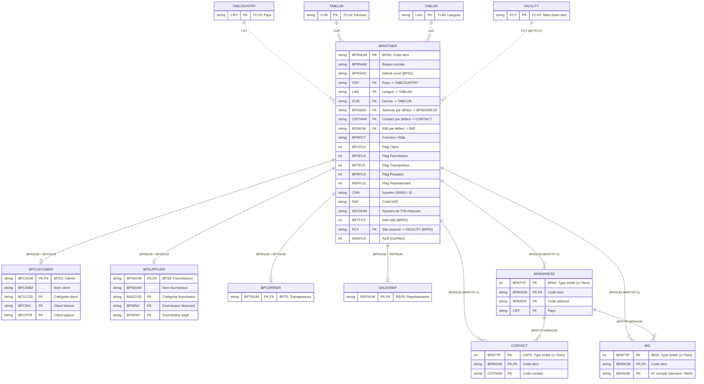

# Table BPARTNER (Tiers / Business Partner)

* **Table:** `BPARTNER`
* **Abbreviation:** `BPR`
* **Module:** Données de base (Common Data)
* **Description:** Central master table storing shared general data for all business partners (customers, suppliers, carriers, prospects, sales reps, and miscellaneous partners) before role-specific extensions.

---

## Physical Data Model (ER Diagram)

---

## Indexes & Keys

| Key | Columns | Duplicates | Description |
| :--- | :--- | :--- | :--- |
| **BPR0** | `BPRNUM` | No | Primary key (Business Partner code) |
| **BPR1** | `BPRSHO` | Yes | Short description search key |
| **BPR2** | `BETFCY + FCY + BPRNUM` | No | Inter-site / Facility partner lookup |

---

## Core Fields Summary

| Column | Description | Type | Linked Table / Expression |
| :--- | :--- | :--- | :--- |
| `BPRNUM` | Business partner code | `BPR` | `[BPR]BPR0=[BPR]BPRNUM` |
| `BPRNAM` | Company / Partner name | `NAM` | — |
| `BPRSHO` | Short name | `SHO` | — |
| `CRY` | Country | `CRY` | `[TCY]TCY0=[BPR]CRY` |
| `LAN` | Language | `LAN` | `[TLA]TLA0=[BPR]LAN` |
| `CUR` | Currency | `CUR` | `[TCU]TCU0=[BPR]CUR` |
| `BPAADD` | Default address | `ADR` | `[BPA]BPA0=1;[BPR]BPRNUM;[BPR]BPAADD` |
| `CNTNAM` | Default contact | `AIN` | `[CNT]CNT0=1;[BPR]BPRNUM;[BPR]CNTNAM` |
| `BIDNUM` | Default bank ID | `BID` | `[BID]BID0=1;[BPR]BPRNUM;[BPR]BIDNUM` |
| `BPCFLG` | Customer flag | `M (1)` | `1 = No, 2 = Yes` (`BPCUSTOMER`) |
| `BPSFLG` | Supplier flag | `M (1)` | `1 = No, 2 = Yes` (`BPSUPPLIER`) |
| `BPTFLG` | Carrier flag | `M (1)` | `1 = No, 2 = Yes` (`BPCARRIER`) |
| `BETFCY` | Inter-site flag | `M (1)` | `1 = No, 2 = Yes` |
| `FCY` | Associated site | `FCY` | `[FCY]FCY0=[BPR]FCY` |
| `CRN` | Company registration no. (SIREN) | `CRN` | — |
| `EECNUM` | EU VAT number | `EEC` | — |
