# Customers (Sage X3 `BPCUSTOMER`): study notes

> Reference notes for designing our own customer table. Sources: the Sage X3 v12 data-model page for `BPCUSTOMER` and the 2009 "Business Partner" physical-model diagram.
> Field descriptions are my own English summary. This is an analysis aid, **not** a schema to copy.

## 1. Table identity

| Property | Value |
|---|---|
| Table | `BPCUSTOMER` |
| Abbreviation | `BPC` |
| Label | Clients (Customers) |
| Module | Données de base (Common Data) |
| Primary key | `BPCNUM` (index `BPC0`, unique — shared 1-to-1 with `BPARTNER.BPRNUM`) |

### Indexes

| Key | Columns | Duplicates | Note |
|---|---|---|---|
| BPC0 | `BPCNUM` | No | Primary key (also FK to `BPARTNER.BPRNUM`) |
| BPC1 | `BPCNAM` | Yes | Search by customer name |

Key idea: `BPCUSTOMER` is a **role extension** of `BPARTNER` (1-to-1, sharing the exact same primary key). It holds commercial, billing, credit, delivery, and tax-regime rules, as well as self-references to separate bill-to (`BPCINV`), pay-by (`BPCPYR`), risk (`BPCRSK`), and group (`BPCGRU`) customer accounts.

## 2. Entity-relationship diagram

Conventions: solid line (`||--`) = mandatory/identifying link (`Bloquant` / `Suppression`), dashed line (`|o..`) = optional or conditional lookup (`R.A.Z.`, `Autre`, `BSRA`, or activity-gated).
Mermaid cannot visually draw per-column arrows, so multi-column foreign keys (`TPT0 = PTE;GCURLEG;1`) are described in the relationship labels.

```mermaid
erDiagram
    %% Core Customer Table & Parent Partner
    BPARTNER {
        string BPRNUM PK "BPR0: Business Partner"
        string CRY FK "country"
        string CRN "SIREN"
        string EECNUM "VAT number"
    }

    BPCUSTOMER {
        string BPCNUM PK,FK "BPC0: Client (shared PK with BPRNUM)"
        string BPCNAM "Raison sociale (BPC1)"
        string BPCSHO "Intitule court"
        string BCGCOD FK "categorie client"
        string BPCINV FK "client facture (bill-to)"
        string BPCPYR FK "client payeur (pay-by)"
        string BPCRSK FK "client risque (credit risk)"
        string BPCGRU FK "client groupe (parent group)"
        string CUR FK "devise"
        string PTE FK "condition paiement"
        string VACBPR FK "regime taxe"
        string ACCCOD FK "code comptable (type 2)"
        string REP FK "representant"
        string PAYBAN FK "banque reglement"
    }

    %% Sub-tables from 2009 Business Partner Diagram
    BPDLVCUST {
        string BPCNUM PK,FK "BPD0: Clients livres (ship-to)"
        string BPAADD PK,FK "adresse livraison"
    }
    BPCUSTMVT {
        string BPCNUM PK,FK "MVC0: Mouvements clients"
        string FINRSPFCY PK,FK "site financier"
    }
    BPADDRESS {
        int BPATYP PK "BPA0: Adresses (1=Tiers)"
        string BPANUM PK
        string BPAADD PK
    }

    %% Core Commercial & Accounting Lookups (v12)
    BPCCATEG {
        string BCGCOD PK "BCG0: Categorie client"
    }
    TABCUR {
        string CUR PK "TCU0: Table des devises"
    }
    TABPAYTERM {
        string PTE PK "TPT0: Conditions paiement"
        string LEG PK
        int PTERAN PK
    }
    TABVACBPR {
        string VACBPR PK "TVB0: Regimes de taxe tiers"
        string LEG PK
    }
    GACCCODE {
        int TYP PK "CAC0: Codes comptables (TYP=2)"
        string ACCCOD PK
    }
    SALESREP {
        string REPNUM PK "REP0: Representants"
    }
    BANK {
        string BAN PK "BAN0: Banque reglement"
    }
    TABSOI {
        string INVCND PK "INVCND0: Conditions facturation"
    }
    TABDEP {
        string DEP PK "TDA0: Escomptes"
    }
    GDA {
        string DIA PK "GDA0: Schema de comptes"
    }
    CACCE {
        string DIE PK "CCE0: Sections analytiques"
        string CCE PK
    }
    GDIE {
        string DIE PK "DIE0: Axes analytiques"
    }
    ATABDIV {
        int NUMTAB PK "ADI: Tables diverses (425, 413, 30+i)"
        string CODE PK
    }
    FACTOR {
        string FCTNUM PK "FCT0: Factors"
    }
    FUPGRP {
        string GRP PK "FGP0: Groupes de relance"
    }
    TABUNAVAIL {
        string UVYCOD PK "UVY0: Periodes indisponibilite"
    }
    CONTTEMPL {
        string COTCHX PK "COT0: Contrat de service"
    }

    %% Shared Primary Key & Self-References (Role Splits)
    BPARTNER ||--o| BPCUSTOMER : "BPCNUM = BPRNUM (Suppression)"
    BPARTNER ||--o{ BPCUSTOMER : "BPCINV (bill-to)"
    BPARTNER ||--o{ BPCUSTOMER : "BPCPYR (pay-by)"
    BPARTNER ||--o{ BPCUSTOMER : "BPCRSK (risk)"
    BPARTNER ||--o{ BPCUSTOMER : "BPCGRU (group)"
    BPARTNER |o..o{ BPCUSTOMER : "BPCCDTISR (credit insurer)"

    %% Addresses & Balances
    BPCUSTOMER ||--o{ BPDLVCUST : "BPCNUM"
    BPADDRESS ||--o{ BPDLVCUST : "1;BPCNUM;BPAADD"
    BPCUSTOMER ||--o{ BPCUSTMVT : "BPCNUM"

    %% Mandatory / Blocking Lookups
    BPCCATEG ||--o{ BPCUSTOMER : "BCGCOD"
    TABCUR ||--o{ BPCUSTOMER : "CUR"
    TABPAYTERM ||--o{ BPCUSTOMER : "PTE;GCURLEG;1"
    TABVACBPR ||--o{ BPCUSTOMER : "VACBPR;GSUPCLE"
    GACCCODE ||--o{ BPCUSTOMER : "2;ACCCOD;GSUPCLE"
    SALESREP ||--o{ BPCUSTOMER : "REP"
    TABSOI ||--o{ BPCUSTOMER : "INVCND;GSUPCLE"
    TABDEP ||--o{ BPCUSTOMER : "DEP;GSUPCLE"
    GDA ||--o{ BPCUSTOMER : "DIA"
    GDIE ||--o{ BPCUSTOMER : "DIE"
    CACCE ||--o{ BPCUSTOMER : "DIE(i);CCE(i)"
    FACTOR ||--o{ BPCUSTOMER : "FCTNUM"
    FUPGRP ||--o{ BPCUSTOMER : "GRP"
    TABUNAVAIL ||--o{ BPCUSTOMER : "UVYCOD2"

    %% Optional / Non-Blocking Lookups
    BANK |o..o{ BPCUSTOMER : "PAYBAN (BSRA)"
    ATABDIV |o..o{ BPCUSTOMER : "BUS (425) / ORIPPT (413) / TSCCOD (30+i)"
    CONTTEMPL |o..o{ BPCUSTOMER : "COTCHX (R.A.Z.)"
```

### Review notes on `BPCUSTOMER` (v12)

1. **Four-party commercial split (`BPCNUM`, `BPCINV`, `BPCPYR`, `BPCRSK`).** Sage X3 separates the *sold-to* customer (`BPCNUM`) from the *bill-to* customer (`BPCINV`), the *pay-by* customer (`BPCPYR`), and the *credit-risk* customer (`BPCRSK`). All four point to `BPARTNER` (`[BPR]BPR0`), which allows a branch to place orders while headquarters gets billed or carries the credit limit.
2. **Addresses are stored as plain codes without FK expressions.** `BPAADD` (default), `BPAINV` (billing), `BPAPYR` (payment), and `BPDADD` (delivery) are `ADR` fields without explicit link expressions on `BPCUSTOMER`—ship-to specifics live in `BPDLVCUST`.
3. **`ACCCOD` uses type `2`.** `[CAC]CAC0=2;ACCCOD;[V]GSUPCLE` confirms type `2` in `GACCCODE` is reserved for customers (compared to `1` for items, `7` for companies, `8` for sites, and `17` for general business partners).
4. **Legislation-scoped lookups (`[V]GSUPCLE` / `[V]GCURLEG`).** Payment terms (`PTE`), tax regimes (`VACBPR`), discounts (`DEP`), and invoicing conditions (`INVCND`) are keyed by legislation/group, not just a flat code.
5. **Two separate e-invoicing flags.** `ELECTINV` (under activity code `EFAT`, with `CNTEFAT` and `STRDATEFAT`) handles French/EU e-invoicing, while `AEIFLG` (under `ELINV`) handles country-specific electronic invoicing.

## 3. Column groups

Columns are grouped by function. "Coded list" means a fixed X3 menu (`M`). "Keep?" is a first suggestion for our own model.

### 3.1 Identity, status and classification

| Column | Meaning | Keep? |
|---|---|---|
| `BPCNUM` | Customer code (PK, shared with `BPARTNER.BPRNUM`) | Yes |
| `BPCNAM`, `BPCSHO` | Legal name, short name (duplicated from `BPARTNER` for fast lookup) | No (keep on `party`) |
| `BCGCOD` | Customer category (FK `BPCCATEG`) | Yes (drives defaults) |
| `BPCSTA` | Active customer flag (`M 1`) | Yes |
| `BPCTYP` | Customer type (`M 401`: normal, miscellaneous, prospect, etc.) | Yes |
| `PPTFLG` | Is a prospect (`M 1`, activity `PPT`) | Optional (or part of `customer_type`) |
| `BPCSNCDAT` | Customer since date | Yes |
| `ABCCLS` | ABC classification (`M 212`: A, B, C, D) | Later |
| `BUS` | Business sector / industry (`ATABDIV` 425) | Optional |
| `TSCCOD` | Statistical families (`ATABDIV` 30+i, activity `STC`) | Maybe, as a lookup/tag |
| `BPCREM` | Internal notes / remarks (250 chars) | Yes |

### 3.2 Partner hierarchy and role splits (self-references to `BPARTNER`)

| Column | Meaning | Keep? |
|---|---|---|
| `BPCINV` | Bill-to customer (`[BPR]BPR0`) | Yes (defaults to self) |
| `BPCPYR` | Pay-by customer (`[BPR]BPR0`) | Optional (only if group billing) |
| `BPCRSK` | Credit-risk customer (`[BPR]BPR0`) | Optional |
| `BPCGRU` | Group / parent customer (`[BPR]BPR0`) | Optional |
| `BPCBPSNUM` | Our supplier number in the customer's system (15 chars) | Yes (useful on invoices/EDI) |

### 3.3 Default addresses & contacts

| Column | Meaning | Keep? |
|---|---|---|
| `BPAADD` | Default address code | Yes (via `party_address`) |
| `BPAINV` | Billing address code | Yes |
| `BPAPYR` | Payment / remittance address code | Optional |
| `BPDADD` | Default ship-to address code | Yes |
| `CNTNAM` | Default contact name | Yes (via `party_contact`) |

### 3.4 Sales, ordering and delivery rules

| Column | Meaning | Keep? |
|---|---|---|
| `REP` | Default sales representative (FK `SALESREP`, activity `REC`) | Yes (FK to `users`) |
| `COMCAT` | Commission category (`M 403`) | Later |
| `PRITYP` | Price type: tax-excluded vs. tax-included (`M 243`: HT / TTC) | Yes |
| `CUR` | Default currency (FK `TABCUR`) | Yes |
| `CHGTYP` | Exchange rate type (`M 202`: daily, monthly, etc.) | Later |
| `DME` | Partial delivery allowed (`M 414`) | Yes |
| `ODL` | One order per delivery note (`M 1`) | Optional |
| `ORDCLE` | Allow order closing / backorder cancellation (`M 1`) | Optional |
| `OCNFLG` | Print order acknowledgement (`M 1`) | Optional |
| `ORDMINAMT` | Minimum order amount | Optional |
| `FREINV` | Freight invoicing rule (`M 402`) | Optional |
| `UVYCOD2` | Customer unavailability calendar (FK `TABUNAVAIL`) | No (unless scheduling deliveries) |
| `ORDFIRDAT` | First order date (system-maintained) | Compute from orders |
| `ORDTEX`, `INVTEX` | Standard header texts for orders and invoices | Later |

### 3.5 Billing, payment terms and dunning

