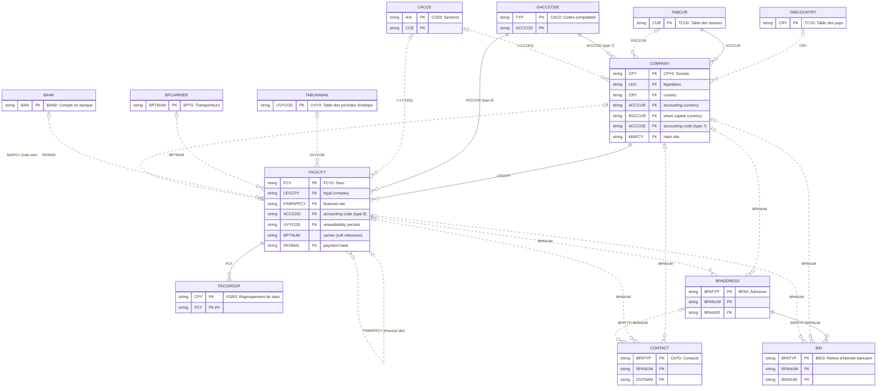

# Company and sites (Sage X3 `COMPANY` and `FACILITY`): study notes

> Reference notes for designing our own company and site tables. Sources: the v12 pages for `COMPANY` and `FACILITY`, and the 2009 "Company and Sites" physical-model diagram.
> Field descriptions are my own English summary. This is an analysis aid, **not** a schema to copy.
> I did not have the pages for `CONTACT`, `BPADDRESS`, `BID`, `FACGROUP`, `BANK`, `TABUNAVAIL` or `BPCARRIER`, so those are described only as the image shows them.

## 1. Table identity

| Property | `COMPANY` | `FACILITY` |
|---|---|---|
| Abbreviation | `CPY` | `FCY` |
| Label | Société (company) | Sites (facilities) |
| Module | Supervisor | Supervisor |
| Primary key | `CPY` (index `CPY0`) | `FCY` (index `FCY0`) |
| Second index | `CPY1`: `LEG` + `CPY` (duplicates allowed) | `FCY1`: `LEGCPY` + `FCY` (no duplicates) |

Key idea: a **company** is a legal entity, and a **site** is an operational location that belongs to exactly one legal company (`FACILITY.LEGCPY`).

## 2. Entity-relationship diagram

Conventions, taken from the source image: solid line = mandatory link, dashed line = optional link (`|o`).
Mermaid cannot show a composite foreign key, so `ITMREF;STOFCY`-style links are described in the label.

### Review notes: image (2009) versus v12 pages

1. **The image is "Version V6.0, March 2009"**, so it misses several links that exist in v12:
   - `COMPANY`: accounting model `ACM` (`GCM`), analytical axis `DIE` (`GDIE`), legislation `LEG` and federal state `STAFED` (both via `ATABDIV`), sectors `SCT1`/`SCT2`, structure code `PLISTC` (`PRS`), `SFINUM` (`SFI`), tax centre `GERTAXCEN` (`BPR`), economic reason `BDFECOCOD`, activity codes `PORCPYACT*` (`CAEC`), users for created/updated by (`AUS`), and the self-reference `PORRESFISCDA` (an invoicing company).
   - `FACILITY`: ten default-warehouse columns linked to `WRH`, plus `DADFCY` and `IVYFCY` (two more self-references, besides `FINRSPFCY`), `LEG`, `CRY` and the audit users.
2. **Circular dependency.** `FACILITY.LEGCPY` (mandatory) points to the company, while `COMPANY.MAIFCY` points back to a site. You cannot insert either row first unless one link is nullable or the constraint is deferred.
3. **`BPTNUM` is a soft reference in v12.** The image draws a dashed link to `BPCARRIER`, but the v12 page shows `BPTNUM` as a plain 10-character field with no link expression.
4. **`ACCCOD` uses a type constant.** The image says `7;ACCCOD` for the company and `8;ACCCOD` for the site, meaning two different "types" of the same accounting-code table. In v12, `COMPANY` links with just `ACCCOD`, and `FACILITY` takes its type from a global variable (`GCACFCY`). Check the `GACCCODE` page before relying on this.
5. **Contacts, addresses and bank details are polymorphic.** `CONTACT`, `BPADDRESS` and `BID` are keyed by `BPATYP + BPANUM`, where the "number" can be a company, a site, a customer, and so on. A real foreign key cannot express that. I drew optional links to both owners.
6. **The "annulation" column is a deletion rule, not optionality** (for example `Bloquant` = deletion of the referenced record is blocked while it is used). I took mandatory or optional from the image instead.
7. **`FACGROUP` (`CPY + FCY`)**: the image only draws its link to the site. The `CPY` part presumably refers to the company, but I did not draw it since the image doesn't.

## 3. `COMPANY` columns by function

"Keep?" is a first suggestion for our own model. Adjust it to what we actually use.

### 3.1 Identity and legal form

| Column | Meaning | Keep? |
|---|---|---|
| `CPY` | Company code (PK) | Yes |
| `CPYNAM`, `CPYSHO` | Legal name, short name | Yes |
| `ARACPYNAM` | Name in Arabic | No (use translations later) |
| `CPYLOG` | Legal form | Yes |
| `CPYLEGFLG` | Is a legal company | Probably |
| `LEG` | Legislation (country rule set) | Yes |
| `CRY` | Country | Yes |
| `IMPCPY` | Implantation | No |
| `BPAADD`, `BIDNUM`, `CNTNAM`, `COMMTYPE` | Default address, bank account, contact, communication type | Yes, via address/contact/bank tables |

### 3.2 Registration and tax identifiers

| Column | Meaning | Keep? |
|---|---|---|
| `CRN` | SIREN number (French company id) | Yes (France) |
| `NAF` | NAF activity code | Yes (France) |
| `NID` | Identification number | Maybe |
| `EECNUM` | VAT number | Yes |
| `EORINUM` | EORI number (customs) | If we import/export |
| `REXNUM`, `ORICERFLG` | REX number, origin self-certification | If we export |
| `VACCPY` | VAT regime | Yes |
| `RGCAMT`, `RGCCUR` | Share capital and its currency | Yes (for invoice legal footers) |
| `SCINUM` | SEPA creditor id | If we do direct debits |
| `SERVICEID` | E-invoicing service id | Later |

### 3.3 Accounting and analytics

| Column | Meaning | Keep? |
|---|---|---|
| `ACCCUR` | Accounting currency | Yes |
| `ACCCOD` | Accounting code (drives default accounts) | Yes, as a mapping table |
| `ACM` | Accounting model | Check its table first |
| `DIE`, `OBYDIE`, `DACDIE` | Analytical axis, mandatory axis, upstream entry of axis | Later |
| `CCE` | Analytical sections (indexed) | Later |
| `STRPER` | Start date of the first fiscal year | Yes |
| `GRUCOD` | Consolidation group | Later |
| `PLISTC`, `SFINUM` | Structure code, invoicing element | Unclear, verify |

### 3.4 Structure

| Column | Meaning | Keep? |
|---|---|---|
| `MAIFCY` | Main site | Yes, but see section 5 |
| `PORRESFISCDA` | Invoicing company (self-reference) | No |

### 3.5 Validity dates

| Column | Meaning |
|---|---|
| `INIPER`, `FINPER` | Start and end dates (one module) |
| `STRDAT`, `ENDDAT` | Start and end dates (another module) |

### 3.6 Localisation and optional modules (not needed for a first version)

Most remaining columns belong to country or module blocks, flagged by activity codes such as `KSP`, `KPO`, `KDE`, `KDEAT`, `KAT`, `KAG`, `KPL`, `KUS`, `FAEDC`, `EFAT`, `LTA`, `IAS`, `WTHMG`, `PAI`. They hold things like tax agent and agency names, thresholds (`SPABPCTSD`, `SPABPSTSD`, `SPAYEATSD`), economic reasons, waste registers and sales-tax activation. Leave them out unless a statutory export requires one.

### 3.7 Audit

`CREDAT`, `CREDATTIM`, `CREUSR`, `UPDDAT`, `UPDDATTIM`, `UPDUSR`, `AUUID` (technical unique id).

## 4. `FACILITY` columns by function

### 4.1 Identity and location

| Column | Meaning | Keep? |
|---|---|---|
| `FCY` | Site code (PK) | Yes |
| `FCYNAM`, `FCYSHO` | Name, short name | Yes |
| `LEGCPY` | Legal company (mandatory) | Yes |
| `LEG` | Legislation | Yes |
| `CRY` | Country | Yes |
| `CRN` | SIRET number (French site id) | Yes (France) |
| `NAF` | NAF code | Yes (France) |
| `EORINUM`, `REXNUM`, `ORICERFLG` | Customs and origin identifiers | If needed |
| `GEOCOD` | Geographic code | No |
| `BPAADD`, `BIDNUM`, `CNTNAM` | Default address, bank account, contact | Yes, via related tables |
| `BPTNUM` | Default carrier (plain reference) | Maybe |
| `SERVICEID` | E-invoicing service id | Later |

### 4.2 Role flags (what the site does)

| Column | Meaning |
|---|---|
| `FINFLG` | Finance site |
| `SALFLG` | Sales |
| `PURFLG` | Purchasing |
| `MFGFLG` | Production |
| `WRHFLG` | Is a warehouse site |
| `WRHGES` | Warehouse management enabled |
| `IVYFLG` | Inventory |
| `DADFLG` | DAS2 declaration |
| `PAYFLG` | Payroll |

### 4.3 Related sites (self-references)

| Column | Meaning |
|---|---|
| `FINRSPFCY` | Financial site responsible for this site's accounting |
| `IVYFCY` | Inventory site |
| `DADFCY` | DAS2 declaring site |

### 4.4 Default warehouses by purpose

| Column | Purpose |
|---|---|
| `RCPWRH` | Receipt |
| `SHIWRH` | Shipping |
| `RTNWRH` | Delivery return |
| `MFGWRH` | Consumption (production) |
| `MFPWRH` | Production order entry |
| `MFRWRH` | Reintegration |
| `SCCWRH` | Subcontracting consumption |
| `SCOWRH` | Subcontracting shipment |
| `TRAWRH` | Internal transfer entry |
| `TRFWRH` | Internal transfer exit |

### 4.5 Accounting and banking

| Column | Meaning |
|---|---|
| `ACCCOD` | Accounting code for the site |
| `CCE`, `DIE` | Analytical sections and axis |
| `PAYBAN` | Bank used for payments |

### 4.6 Availability calendar

| Column | Meaning |
|---|---|
| `UVYCOD` | Unavailability period table |
| `UVYDAY` | Unavailable weekdays (7 flags, Monday to Sunday) |
| `STRHOU`, `ENDHOU` | Daily start and end hours |

### 4.7 HR and payroll block (activity `HRPAY`, French payroll)

`BPADCL`, `BPASGE`, `CHEF`, `CLLCVT`, `CNTDDS`, `CODCRA`, `FLGAPP`, `FLGFOR`, `FLGPEC`, `HRMDADFCY`, `HRMDADFLG`, `HRMPAYBAN`, `HRMTAXWAG`, `PRF`, `REGPRH`, `RSKWRK`, `SECPRH`, `SRV`. Not needed unless we build payroll.

### 4.8 Other

`SPAOPEIGIC` (IGIC operations, Canary Islands tax) and `INSCTYFLG` (city-limits flag) are localisation columns. Audit columns are the same as for `COMPANY`.

## 5. Takeaways for our own model

1. **Keep company and site separate.** The company holds legal identity, currency and fiscal settings. The site holds operations and always references one legal company.
2. **Handle the circular reference.** Do not store the main site on the company. Put `is_main_site boolean` on the site with a partial unique index (one main site per company), or make `main_site_id` nullable and set it after the first site exists.
3. **Replace ten warehouse columns with a table**: `site_default_warehouse(site, purpose, warehouse)` with `purpose` from a small lookup.
4. **Avoid polymorphic keys** (`BPATYP + BPANUM`). Use separate `company_address`, `site_address`, and so on, or one `address` table with `owner_type`, `owner_id` and a check constraint plus trigger.
5. **Replace the role flags** (`FINFLG`, `SALFLG`, ...) with booleans or a `site_role` table. Decide if we need the "financial site" concept at all: it matters when several sites post into one set of books.
6. **Keep France-specific data explicit**: SIREN on the company (9 digits), SIRET on the site (14 digits, starting with the SIREN), NAF code, VAT number. Our accounting export (FEC) needs the SIREN.
7. **Leave HR, payroll and other-country blocks out of version 1.**
8. **Order of creation matters for items**: `ITMFACILIT.STOFCY` and `ITMCATEG.STOFCY` reference `FACILITY`, so sites must exist before per-site item data.

## 6. Open questions

- Do we have one legal company or several? Several changes consolidation, intercompany and numbering rules.
- Do we need several sites, and do any share one set of books?
- Which warehouses and purposes do we really use?
- Which columns are filled in our X3 instance? Query `COMPANY` and `FACILITY` for always-empty columns.
- Which tax identifiers appear on our invoices and statutory exports?