# Item master (Sage X3 `ITMMASTER`): study notes

> Reference notes for designing our own item table. Based on the Sage X3 v12 data-model page for `ITMMASTER` and the 2009 "Item" physical-model diagram.
> The field descriptions are my own summary in English. This is an analysis aid, **not** a schema to copy.

## 1. Table identity

| Property | Value |
|---|---|
| Table | `ITMMASTER` |
| Abbreviation | `ITM` |
| Label | Articles (items) |
| Module | Master data |
| Primary key | `ITMREF` (index `ITM0`, unique) |

### Indexes

| Key | Columns | Duplicates | Note |
|---|---|---|---|
| ITM0 | `ITMREF` | No | Primary key |
| ITM1 | `ITMDES1` | Yes | Search by description |
| ITM2 | `SEAKEY` + `ITMREF` | No | Search key |
| ITM3 | `CFGLIN` + `ITMREF` | No | By product line |
| ITM4 | `CFGVCRNUM` + `ITMREF` | No | Only with configurator activity code `CFG` |
| ITM5 | `PLMITMREF` + `ITMREF` | No | Only with PLM activity code `PLM` |

## 2. Entity-relationship diagram (corrected)

Changes versus the original diagram:
- Optional relationships use `|o..o{` (the parent is optional), not `||..o{`.
- `SEASON` to `ITMFACILIT` is optional (dashed in the source image), so it is now dashed.
- `TABUNIT` link now lists `PCU[1..4]`, as in the image.
- `ITMMASTER` now shows its main foreign-key columns.

```mermaid
erDiagram
    ITMMASTER {
        string ITMREF PK "ITM0: Articles"
        string TCLCOD FK "category"
        string ACCCOD FK "accounting code"
        string SAU FK "sales unit"
        string STU FK "stock unit"
        string PUU FK "purchase unit"
        string BUY FK "buyer"
        string PLANNER FK "planner"
    }
    ITMFACILIT {
        string ITMREF PK,FK "ITF0: Articles - Sites"
        string STOFCY PK,FK
        string REOPOL FK
        string SESCOD FK
    }
    GACCCODE {
        string TYP PK "CAC0: Codes comptables"
        string ACCCOD PK
    }
    ATABDIV_20 {
        string NUMTAB PK "20;STJ: Tables diverses"
        string CODE PK
    }
    TABUNIT {
        string UOM PK "TUN0: Table des unites"
    }
    CACCE {
        string AXI PK "CCE0: Sections"
        string CCE PK
    }
    ATABDIV_2 {
        string NUMTAB PK "2;VACITM[1..3]: Tables diverses"
        string CODE PK
    }
    ITMCATEG {
        string STOFCY PK "ITG0/ITG1: Categorie article"
        string TCLCOD PK
    }
    CONTTEMPL {
        string CONNUM PK "COT0: Modele de contrat de service"
    }
    TABLINCFG {
        string CFGLIN PK "TLP0: Lignes de produits"
    }
    ITMSALES {
        string ITMREF PK,FK "ITS0: Articles - ventes"
    }
    ITMBPS {
        string ITMREF PK,FK "ITP0/ITP2: Articles-Fournisseurs"
        string BPSNUM PK,FK
    }
    ITMBPC {
        string ITMREF PK,FK "ITU0/ITU1: Articles - Clients"
        string BPCNUM PK,FK
    }
    TABREOPOL {
        string REOPOL PK "TRP0: Table des politiques reappro"
    }
    ITMMVTHIS {
        string ITMREF PK,FK "ITH0: Historique cumuls Article-Site"
        string STOFCY PK,FK
        int YEA PK
        int MON PK
    }
    ITMMVT {
        string ITMREF PK,FK "ITV0: Cumuls Article-Site"
        string STOFCY PK,FK
    }
    AUTILIS {
        string USR PK "CODUSR: Utilisateurs"
    }
    ITMCOST {
        string STOFCY PK,FK "ITC0: Articles - Couts"
        string ITMREF PK,FK
        string CSTTYP PK
        int YEA PK
        int CSTSEQ PK
    }
    BPCUSTOMER {
        string BPCNUM PK "BPC0: Clients"
    }
    SEASON {
        string SESCOD PK "SES0: Saisonnalites"
    }
    FACILITY {
        string FCY PK "FCY0: Sites"
    }
    ITMABCWRK {
        string STOFCY PK,FK "ITK0: Calcul classe ABC"
        string ITMREF PK,FK
    }
    ITMBOM {
        string ITMREF PK,FK "ITB0: Articles - Nomenclatures"
        string BOMALT PK
    }
    BPSUPPLIER {
        string BPSNUM PK "BPS0: Fournisseurs"
    }

    %% Dashed = non-identifying lookup. |o = optional parent.
    GACCCODE |o..o{ ITMMASTER : "ACCCOD"
    ATABDIV_20 |o..o{ ITMMASTER : "20;STJ"
    TABUNIT |o..o{ ITMMASTER : "SAU / STU / EEU / PUU / WEU / SSU / PCU[1..4]"
    CACCE |o..o{ ITMMASTER : "i+1;CCE(i)"
    ATABDIV_2 |o..o{ ITMMASTER : "2;VACITM[1..3]"
    ITMCATEG ||--o{ ITMMASTER : "TCLCOD"
    CONTTEMPL |o..o{ ITMMASTER : "TPLCONGUA / TPLCONSRV"
    TABLINCFG |o..o{ ITMMASTER : "CFGLIN"
    AUTILIS |o..o{ ITMMASTER : "BUY / PLANNER"

    ITMMASTER ||--o| ITMSALES : "ITMREF"
    ITMMASTER ||--o{ ITMBPS : "ITMREF"
    ITMMASTER ||--o{ ITMBPC : "ITMREF"
    ITMMASTER ||--o{ ITMFACILIT : "ITMREF"
    ITMMASTER ||--o{ ITMBOM : "ITMREF"

    BPCUSTOMER ||--o{ ITMBPC : "BPCNUM"
    BPSUPPLIER ||--o{ ITMBPS : "BPSNUM"

    TABREOPOL |o..o{ ITMFACILIT : "REOPOL"
    SEASON |o..o{ ITMFACILIT : "SESCOD"
    AUTILIS |o..o{ ITMFACILIT : "BUY / PLANNER"
    FACILITY ||--o{ ITMFACILIT : "STOFCY"
    ITMFACILIT ||--o{ ITMMVT : "ITMREF;STOFCY"
    ITMFACILIT ||--o{ ITMCOST : "ITMREF;STOFCY"
    ITMFACILIT ||--o{ ITMABCWRK : "ITMREF;STOFCY"
    ITMMVT ||--o{ ITMMVTHIS : "ITMREF;STOFCY"
```

### Review notes on the diagram

1. **It is outdated.** The image is "Version V6.0, March 2009". The v12 table has many more links (company `CPY`, analytical axis `DIE`, business partner `BPARTNER` for configurator, customs nomenclature `ITMCUSNOM`, matching rule `MATCHTOL`, UN numbers `TABUNNBR`, counters `ACODNUM`, label reports `AREPORT`, BOM and routing alternatives, versioning counters `ITMCPTVER`, project cost centers `PJMCOSTCTR`).
2. **`ITMCATEG` has a composite key `STOFCY + TCLCOD`**, but `ITMMASTER` references it with `ITG0="";TCLCOD`. That means the item points to the *global* category (empty site). Categories can be overridden per site.
3. **`ATABDIV` appears twice** (`ATABDIV_20`, `ATABDIV_2`) only to show different table numbers. In reality it is one generic "miscellaneous tables" table, a pattern worth avoiding in our model: use one real lookup table per concept.
4. **`GACCCODE`** is keyed by `TYP + ACCCOD`, and `ITMMASTER` links with `TYP = 1`.
5. **Mermaid limitation:** the `FK` marker on `ITMMASTER` columns is documentation only. Mermaid does not draw per-column links.

## 3. Column groups

Columns are grouped by function. "Coded list" means the value comes from a fixed menu of options. "Keep?" is a first suggestion for our own model and should be adjusted to what we actually use.

### 3.1 Identity and description

| Column | Meaning | Keep? |
|---|---|---|
| `ITMREF` | Item code (PK) | Yes |
| `ITMDES1`, `ITMDES2`, `ITMDES3` | Descriptions 1 to 3 | Yes (one description, plus long text) |
| `DES1AXX`, `DES2AXX`, `DES3AXX` | Translated descriptions (multi-language) | Later, as a separate translation table |
| `SEAKEY` | Search key | Probably a search index instead |
| `EANCOD`, `GTIN` | Barcode identifiers | Yes |
| `ITMSTD` | Standard or norm reference | Optional |
| `PLMITMREF`, `PLMATTURL`, `PLMHISURL` | PLM (product lifecycle) integration | No |

### 3.2 Status, lifecycle and type

| Column | Meaning | Keep? |
|---|---|---|
| `ITMSTA` | Item status (coded list) | Yes |
| `LIFSTRDAT`, `LIFENDDAT` | Start and end of life dates | Yes |
| `RPLITM` | Replacement item (self-reference) | Optional |
| `HDKITMTYP`, `INVPRODTYP` | Item type (coded lists) | Yes, one type column |
| `GENFLG`, `INTFLG`, `PHAFLG`, `NPIPRO`, `TOOFLG` | Flags: generic, intermediate, phantom, prototype, tooling | Only if needed |
| `FLGFAS` | Can be a fixed asset | Only if needed |

### 3.3 Classification

| Column | Meaning | Keep? |
|---|---|---|
| `TCLCOD` | Category (FK to `ITMCATEG`) | Yes |
| `TSICOD` | Statistical families (indexed, several levels) | Maybe, as a many-to-many |
| `CSTGRP`, `BRDCOD` | Cost families | Maybe |
| `CFGLIN` | Product line (FK to `TABLINCFG`) | Optional |

### 3.4 Units of measure and conversions

| Column | Meaning |
|---|---|
| `STU` | Stock unit |
| `SAU` | Sales unit |
| `PUU` | Purchase unit |
| `SSU` | Statistical unit |
| `EEU` | Supplementary unit for the EU trade declaration (DEB) |
| `PCU` | Packaging unit |
| `WEU`, `VOU` | Weight unit, volume unit |
| `DAYUOM`, `HOUUOM`, `MNTUOM` | Time units (day, hour, minute) |
| `SAUSTUCOE`, `PUUSTUCOE`, `SSUSTUCOE`, `EEUSTUCOE`, `PCUSTUCOE` | Conversion coefficient from each unit to the stock unit |
| `DACSAUCOE`, `DACPUUCOE`, `DACPCUCOE` | Whether the coefficient may be edited on documents |
| `ITMWEI`, `ITMVOU`, `DTY` | Weight and volume of the stock unit, density |

Design note: X3 stores one "coefficient to stock unit" per unit type. A cleaner model is an `item_uom` table (item, unit, factor, role).

### 3.5 Behaviour flags (what the item is used for)

| Column | Meaning |
|---|---|
| `PURFLG` | Purchased |
| `SALFLG` | Sold |
| `MFGFLG` | Manufactured |
| `SCPFLG`, `SCSFLG` | Subcontracted / used in subcontracting |
| `PRQFLG` | Purchase request mandatory |
| `DLVFLG` | Deliverable |
| `RCPFLG` | Receipt code |

### 3.6 Stock, tracking and expiry

| Column | Meaning |
|---|---|
| `STOMGTCOD`, `STDFLG` | Stock management mode (coded lists) |
| `NEGSTO` | Negative stock allowed |
| `STOISSDEF`, `PCURUL` | Default stock issue rule |
| `STOCRD` | Storage card |
| `LOTMGTCOD`, `LOTCOU` | Lot management mode and lot number counter |
| `SERMGTCOD`, `SERCOU` | Serial number management and counter |
| `TRKCOD`, `TRKLEV` | Traceability code and level |
| `EXYMGTCOD`, `EXYSTA` | Expiry management and status |
| `SHL`, `SHLUOM` | Shelf life and its time unit |
| `SHLLTI`, `SHLLTIUOM`, `NEWLTISTA` | Re-test delay, its unit and status |

### 3.7 Planning and replenishment

| Column | Meaning |
|---|---|
| `BUY` | Buyer (FK to user) |
| `PLANNER` | Planner (FK to user) |
| `OFS` | Replenishment lead time |
| `FIMHOR`, `FIMHORUOM` | Firm planning horizon and unit |
| `FRTHOR`, `FRTHORUOM` | Planning horizon and unit |
| `MINRMNPRC` | Remainder tolerance (%) |

Note: most real planning parameters live per site in `ITMFACILIT`, not here.

### 3.8 Accounting and tax

| Column | Meaning |
|---|---|
| `ACCCOD` | Accounting code (drives which accounts are used on posting) |
| `VACITM` | Tax levels (3 levels, indexed) |
| `DIE`, `CCE` | Analytical axis and sections |
| `PCCCOD` | Expense type (project module) |
| `STATAXFLG`, `ITMEXNFLG` | Taxability and exemption flags |
| `SSTCOD` | Special tax code |
| `STAFED` | Region/state |
| `ITMSFTTYP` | Item type for the SAF-T audit export |

This group matters most for our finance link: an item should resolve to accounts through a category or accounting-code table, never by storing account numbers on each item.

### 3.9 Costs and prices

| Column | Meaning |
|---|---|
| `PURBASPRI` | Base purchase price |
| `CPRAMT` | Fixed unit cost |
| `CPRCOE` | Landed-cost (approach) coefficient |
| `STCNUM` | Cost structure reference |
| `MATTOL` | Invoice matching tolerance rule |

### 3.10 Customs and regulatory

| Column | Meaning |
|---|---|
| `CUSREF` | Customs nomenclature reference |
| `EECGES` | Subject to EU trade declaration (DEB) |
| `UNNBR` | UN number (dangerous goods) |
| `ALG`, `ALGBOM`, `ALGDAT` | Allergens and their change date |

### 3.11 Texts, labels, contracts

| Column | Meaning |
|---|---|
| `MFGTEX`, `PURTEX` | Production text, purchase text |
| `LBEFMT`, `STULBEFMT` | Label formats |
| `TPLCONGUA`, `TPLCONLND`, `TPLCONSRV` | Warranty, loan and service contract templates |
| `PITCDT`, `PITCDTUOM` | Tokens to credit and unit |
| `FLYCAT` | Coupon category |
| `EXPNUM` | Export number |
| `DEFACT`, `DEFPOT` | Default strength (units / %) |
| `DLU` | Usage-date coefficient |
| `PLAACS` | Manager access code |

### 3.12 Optional X3 add-on blocks (not needed for a first version)

| Prefix | Purpose |
|---|---|
| `CFG*` | Product configurator (reference item, partner, free fields, purge date) |
| `ECC*`, `LOAECCFLG`, `ALTBOMHDK` | Versioning of item, BOM and routing |

### 3.13 Audit and technical columns

| Column | Meaning |
|---|---|
| `CPY` | Company |
| `CREDAT`, `CREDATTIM`, `CREUSR` | Created on / at / by |
| `UPDDAT`, `UPDDATTIM`, `UPDUSR` | Updated on / at / by |
| `AUUID` | Unique technical identifier |
| `CREMAC` | Equipment/asset creation flag |

## 4. Related tables

| Table | Role |
|---|---|
| `ITMFACILIT` | Item settings per site (replenishment policy, season, buyer, planner) |
| `ITMSALES` | Sales-specific data (1 to 1 with the item) |
| `ITMBPS` | Item-supplier references (purchasing) |
| `ITMBPC` | Item-customer references |
| `ITMBOM` | Bills of materials |
| `ITMMVT`, `ITMMVTHIS` | Movement totals per item/site, and monthly history |
| `ITMCOST` | Costs per item/site/type/year |
| `ITMABCWRK` | ABC classification work table |
| `ITMCATEG` | Item categories |

## 5. Takeaways for our own model

1. Split a **global item** (identity, type, units, category, status) from **per-site data** (planning, stock policy, costs).
2. Keep **units and conversions** in a dedicated table instead of many `*UOM` and `*COE` columns.
3. Replace the many `*FLG` columns and coded menus with proper lookup tables or enums, with constraints.
4. Link items to the ledger through **category to accounting mapping**.
5. Keep lots, serials, expiry, customs, allergens, configurator and versioning out of version 1 unless the business needs them.
6. Add the audit columns (created/updated by and when) from day one.

## 6. Open questions

- Which of these columns does our X3 instance actually populate? (Check for always-empty columns in production data.)
- Do we need multi-site items, lots/serials, or multi-language descriptions at launch?
- Which statutory exports (FEC, VAT, intra-EU declaration) must the item data feed?